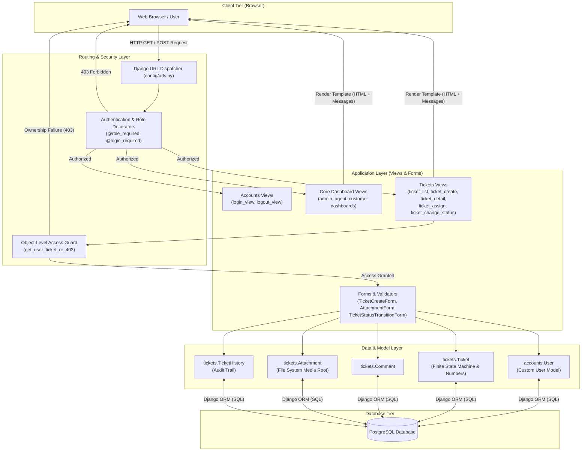
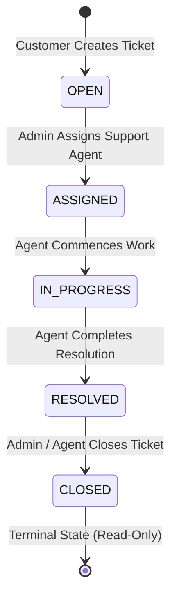
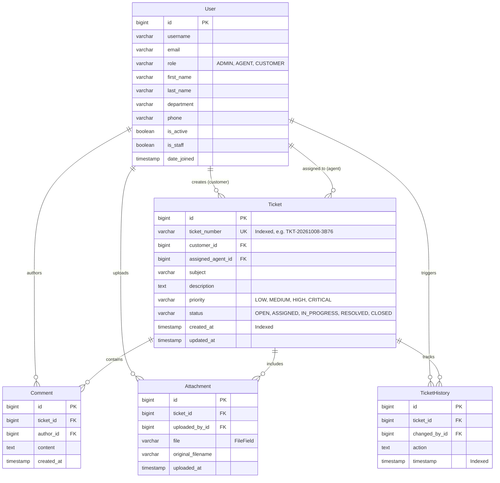

# SupportDesk — Helpdesk & Support Ticket Management System

[](https://www.python.org/)
[](https://www.djangoproject.com/)
[](https://www.postgresql.org/)
[](#p-automated-testing)
[](#u-contribution-and-license)

---

## A. Project Title and Overview

**SupportDesk** is an enterprise-grade Helpdesk and Support Ticket Management System built with Python and Django. Designed as a robust internal tool, SupportDesk bridges communication between end customers, technical support agents, and system administrators through structured, auditable issue tracking.

### The Problem It Solves
In modern business and IT support workflows, informal communication channels (such as unmonitored email threads or direct messages) cause customer inquiries to fall through the cracks. Organizations struggle with:
- Unclear ticket ownership and lack of responsibility assignment.
- Undocumented status changes without an audit history.
- Unvalidated file uploads posing potential security threats.
- Cross-customer data leakage and improper boundary access.

### Primary Objectives and Intended Users
SupportDesk replaces fragmented workflows with a secure, centralized web platform governed by strict role-based access control (RBAC). Its core goals include:
1. **Accountability**: Automated tracking of who performed every ticket creation, assignment, transition, comment, and attachment.
2. **Access Isolation**: Enforcing strict tenant-like boundaries so customers only see their own tickets, agents only see tickets assigned to them, and administrators have global visibility.
3. **Finite-State Workflow Integrity**: Guaranteeing that tickets advance through a verified lifecycle without illegal status skips.
4. **Target Users**:
   - **Customers**: Submit issues with detailed descriptions, upload diagnostic logs/screenshots, monitor resolution progress, and participate in comment discussions.
   - **Support Agents**: Prioritize and work assigned tickets, update progress statuses, communicate with customers, and resolve technical issues.
   - **Administrators**: Oversee system-wide ticket queues, assign and reassign tickets to qualified agents, and manage user accounts and system configuration.

---

## B. Key Features

SupportDesk incorporates functionality across key functional areas:

### 1. Authentication & Role-Based Access Control
- Custom User model (`accounts.User`) extending Django's `AbstractUser`, featuring explicit system roles (`ADMIN`, `AGENT`, `CUSTOMER`).
- Custom view decorators (`@role_required`, `@admin_required`, `@agent_or_admin_required`) enforcing authentication and authorization checks before view execution.
- Dedicated HTTP 403 Access Denied template (`templates/403.html`) rendered on unauthorized access attempts.

### 2. Customer Ticket Management
- Dedicated submission form (`TicketCreateForm`) allowing customers to specify issue subjects, detailed descriptions, priorities, and optional initial attachments.
- Automatic generation of unique, human-readable ticket numbers (e.g., `TKT-20261008-3B76`) upon ticket creation.
- Initial status automatically pinned to `OPEN` with immediate creation of an initial audit entry in `TicketHistory`.

### 3. Support Agent Operations
- Tailored agent dashboard displaying metrics strictly scoped to the authenticated agent (Total Assigned, Assigned, In Progress, Resolved).
- Scoped ticket list filtering out unassigned tickets and tickets assigned to other support engineers.
- Capability to advance ticket lifecycle states (`ASSIGNED → IN_PROGRESS → RESOLVED`) with mandatory history recording.

### 4. Administrator Operations
- Comprehensive administrative dashboard summarizing global ticket metrics (Total, Open, Assigned, In Progress, Resolved, Closed).
- Centralized assignment interface (`TicketAssignForm`) allowing administrators to route any ticket to an active support agent.
- Automatic lifecycle progression: Assigning an `OPEN` ticket immediately promotes it to `ASSIGNED` and logs the assignment event in the audit trail.
- Direct integration with Django's administrative interface (`/admin/`) for user and profile management.

### 5. Ticket Lifecycle & Finite Status Management
- Enforced finite-state machine (FSM) defining valid status progressions:
  $$\text{OPEN} \longrightarrow \text{ASSIGNED} \longrightarrow \text{IN\_PROGRESS} \longrightarrow \text{RESOLVED} \longrightarrow \text{CLOSED}$$
- Rejection of invalid status transitions (e.g., jumping directly from `OPEN` to `CLOSED` or `RESOLVED`) at both model and view layers.
- `CLOSED` is a permanent terminal state with no subsequent transitions permitted.

### 6. Comments & Conversations
- Chronological discussion thread per ticket (`Comment` model), attributing each entry to its author and timestamp.
- Strict input validation rejecting empty or whitespace-only messages.
- Terminal-state lockdown: Customers are restricted from posting comments on `CLOSED` tickets.

### 7. File Attachments & Security Validation
- Secure file upload handling (`Attachment` model) organized into ticket-specific media folders (`media/attachments/<ticket_number>/<filename>`).
- Strict file extension allowlist validation:
  - Documents: `pdf`, `doc`, `docx`, `xls`, `xlsx`, `csv`, `txt`
  - Images: `png`, `jpg`, `jpeg`, `gif`, `webp`
  - Archives & Logs: `zip`, `tar`, `gz`, `log`
- Rejection of executable binaries (e.g., `.exe`, `.bat`, `.sh`) and a maximum upload size limit of 10 MB per file.

### 8. Ticket History & Audit Trail
- Automated logging of every critical event in `TicketHistory` (ticket creation, status transitions, agent assignments, comment additions, and attachment uploads).
- Read-only historical log displaying the actor, action description, and timestamp.

### 9. Search, Filters & Dashboards
- Multi-parameter filtering via `TicketFilterForm` supporting:
  - Free-text search across ticket numbers, subjects, and descriptions (`Q` objects).
  - Status dropdown filter.
  - Priority dropdown filter (`LOW`, `MEDIUM`, `HIGH`, `CRITICAL`).
  - Agent filter (available exclusively to administrators).
- Dynamic metrics computation directly from PostgreSQL aggregate counts.

### 10. REST API Foundation
- `djangorestframework` (v3.15.2) installed and configured in `config/settings/base.py` with session authentication, authenticated-by-default permissions, and page-number pagination (`PAGE_SIZE = 25`).
- *Current Status*: Ready for API serialisation; the current application endpoints are served via server-rendered Django templates and forms.

### 11. Input Validation, Access Control & Error Handling
- Validation across all forms with error messages delivered via Django's messaging framework (`messages.error`, `messages.success`).
- Strict object-level permission helper (`get_user_ticket_or_403`) preventing URL manipulation and cross-tenant access.

---

## C. User Roles and Permissions

| Role | Responsibilities | Accessible Functionality | Restrictions |
| :--- | :--- | :--- | :--- |
| **Admin** (`ADMIN`) | System oversight, agent workload management, administrative maintenance. | • Global ticket visibility (all tickets across all users).<br>• Assign/reassign tickets to agents.<br>• Perform any valid status transition.<br>• Access Admin Dashboard and Django Admin (`/admin/`).<br>• Comment and upload attachments on any ticket.<br>• Filter tickets by assigned agent. | • Must adhere to valid status transition sequences (cannot perform illegal transitions).<br>• Cannot modify or reopen a `CLOSED` ticket. |
| **Support Agent** (`AGENT`) | Technical triage, ticket resolution, customer communication. | • View tickets assigned directly to them.<br>• Advance status (`ASSIGNED → IN_PROGRESS → RESOLVED`).<br>• Access Agent Dashboard.<br>• Post comments and upload attachments on assigned tickets.<br>• Filter assigned tickets by status, priority, and keyword. | • Cannot view tickets assigned to other agents or unassigned tickets (403 Denied).<br>• Cannot create new tickets on behalf of customers.<br>• Cannot assign or reassign tickets to other agents.<br>• Cannot transition tickets directly to `CLOSED` without going through `RESOLVED`. |
| **Customer** (`CUSTOMER`) | Issue reporting, tracking submitted inquiries, providing troubleshooting feedback. | • Create new support tickets with initial attachments.<br>• View personal tickets and personal submission history.<br>• Access Customer Dashboard.<br>• Post comments and upload files to active personal tickets.<br>• Filter personal tickets by status, priority, and keyword. | • Cannot view tickets created by other customers (403 Denied).<br>• Cannot change ticket status or assign agents.<br>• Cannot access the administrative or agent dashboards.<br>• Cannot post comments or upload files to `CLOSED` tickets. |

---

## D. Technology Stack

| Component / Layer | Technology | Version | Purpose in SupportDesk |
| :--- | :--- | :--- | :--- |
| **Programming Language** | Python | `3.11` – `3.14` | Primary backend runtime. Includes compatibility layer for Django 5.1 on Python 3.14. |
| **Web Framework** | Django | `5.1.4` | Full-stack MVC/MVT framework providing URL dispatching, ORM, authentication, CSRF security, and templating. |
| **Database Engine** | PostgreSQL | `14+` / `16` | Relational database handling transactions, indexes, foreign keys, and audit logging. |
| **Database Adapter** | psycopg2-binary | `2.9.10` | High-performance PostgreSQL database adapter for Python/Django ORM. |
| **API Framework** | Django REST Framework | `3.15.2` | Installed and registered in settings as the foundation for future REST API serializers. |
| **Environment Configuration** | python-dotenv | `1.0.1` | Loads decoupled environment variables (`.env`) into Django settings. |
| **Frontend Templates** | Django Template Engine | Built-in | Server-side template rendering with template inheritance (`base.html`), role-based block isolation, and context processors. |
| **Frontend Styling** | Vanilla CSS3 | Custom | Clean, responsive internal tool interface (`static/css/main.css`) using CSS Grid, Flexbox, custom design tokens, and neutral color scales. Zero heavy external CSS frameworks. |
| **Frontend Icons** | Inline SVG | Scalable vector icons embedded directly into templates for minimal load times. |
| **Testing Suite** | Django Test Runner | Built-in | Automated testing suite using `django.test.TestCase` to execute isolated transactional unit and integration tests. |

---

## E. System Architecture

SupportDesk follows the standard Django Model-View-Template (MVT) architecture with strict separation between business logic, data models, and access control.



### Request Lifecycle
1. **Request Intake**: A user submits an HTTP request to an endpoint (e.g., `/tickets/15/status/`).
2. **Routing & Authentication**: `config/urls.py` delegates to app-specific URL configurations. The view checks authentication via `@login_required` and role decorators.
3. **Authorization & Boundary Verification**: Views verify object-level ownership using `get_user_ticket_or_403`. If a customer attempts to inspect another customer's ticket, an HTTP 403 response is returned immediately.
4. **Validation & State Transition**: Submitted form data is processed. For status updates, `ticket.can_transition_to()` checks the finite-state machine rules.
5. **Persistence & Auditing**: The ticket is updated and a new `TicketHistory` entry is persisted to PostgreSQL within the database transaction.
6. **Response Rendering**: The user is redirected or provided a rendered HTML template reflecting the updated state.

---

## F. Project Directory Structure

```
supportdesk/
├── manage.py                          # Django management script
├── requirements.txt                   # Project Python dependencies
├── .env.example                       # Template for environment configuration
├── .gitignore                         # Version control exclusions
├── Manual-Test-Report.docx            # Documented manual testing report
├── docs/                              # Project documentation & scripts
│   └── sql_queries.sql                # Verified PostgreSQL analytical reporting queries
├── accounts/                          # Custom user management & authentication app
│   ├── admin.py                       # User model registration in Django admin
│   ├── apps.py                        # Accounts app configuration
│   ├── forms.py                       # LoginForm with custom styling
│   ├── models.py                      # Custom User model with Role definitions
│   ├── tests.py                       # Accounts test file
│   ├── urls.py                        # Authentication URL patterns (/accounts/login, etc.)
│   ├── views.py                       # Login and logout view handlers
│   └── migrations/
│       └── 0001_initial.py            # Initial User table migration
├── config/                            # Project configuration package
│   ├── asgi.py                        # ASGI entrypoint
│   ├── urls.py                        # Root URL routing configuration
│   ├── wsgi.py                        # WSGI entrypoint
│   └── settings/                      # Modular settings package
│       ├── __init__.py
│       ├── base.py                    # Base settings (apps, middleware, DRF, templates)
│       ├── check.py                   # Temporary SQLite verification settings
│       └── local.py                   # Development settings (loads .env, PostgreSQL)
├── core/                              # Core application & role dashboards
│   ├── admin.py                       # Core admin registration
│   ├── apps.py                        # Core app configuration
│   ├── decorators.py                  # Role access decorators (@role_required, etc.)
│   ├── models.py                      # Core models
│   ├── tests.py                       # Core tests
│   ├── urls.py                        # Dashboard URL patterns
│   └── views.py                       # Role router & dashboard metric views
├── tickets/                           # Ticket lifecycle, comments, attachments app
│   ├── admin.py                       # Ticket, Comment, Attachment, History admin inlines
│   ├── apps.py                        # Tickets app configuration
│   ├── forms.py                       # Ticket creation, assignment, transition, comment forms
│   ├── models.py                      # Ticket, Comment, Attachment, TicketHistory models
│   ├── tests.py                       # 18 automated unit and integration tests
│   ├── urls.py                        # Ticket URL patterns (/tickets/, /tickets/new/, etc.)
│   ├── views.py                       # List, create, detail, comment, upload, transition views
│   └── migrations/
│       └── 0001_initial.py            # Ticket tables and index migrations
├── templates/                         # Server-rendered HTML templates
│   ├── 403.html                       # Custom HTTP 403 Access Denied template
│   ├── 404.html                       # Custom HTTP 404 Not Found template
│   ├── base.html                      # Primary layout with responsive navigation & topbar
│   ├── accounts/
│   │   └── login.html                 # Login page template
│   ├── core/
│   │   ├── dashboard_admin.html       # Administrator dashboard template
│   │   ├── dashboard_agent.html       # Support agent dashboard template
│   │   └── dashboard_customer.html    # Customer dashboard template
│   └── tickets/
│       ├── ticket_create.html         # New ticket submission form template
│       ├── ticket_detail.html         # Comprehensive ticket details, discussion, history
│       └── ticket_list.html           # Ticket table with search & filtering controls
├── static/                            # Static asset files
│   └── css/
│       └── main.css                   # Custom responsive stylesheet
└── media/                             # User-uploaded attachments (runtime generated)
    └── attachments/                   # Scoped storage: attachments/<ticket_number>/<filename>
```

---

## G. Prerequisites

Before installing and running SupportDesk, ensure your host environment meets the following requirements:

1. **Operating System**: Windows 10/11, macOS, or Linux.
2. **Python**: Python `3.11` to `3.14` (verified on Python `3.14.7` with built-in compatibility patch in `config/settings/base.py`).
3. **pip**: Python package installer (included with Python).
4. **Git**: Version control client.
5. **PostgreSQL**: PostgreSQL `14+` running locally or accessible across your network.
   > [!IMPORTANT]
   > The local development environment of the author used PostgreSQL on port **`8080`**. The default PostgreSQL port is **`5432`**. Make sure to set `DB_PORT` in your `.env` to match your local PostgreSQL server configuration.

---

## H. Installation and Setup

Follow these step-by-step instructions in **Windows PowerShell** to configure and run the project locally.

### Step 1: Clone the Repository
```powershell
git clone https://github.com/atharvakanekar22-dev/SupportDesk.git
cd SupportDesk
```

### Step 2: Create and Activate a Virtual Environment
```powershell
python -m venv .venv
.\.venv\Scripts\Activate.ps1
```
*(On Unix/macOS, use: `source .venv/bin/activate`)*

### Step 3: Install Required Dependencies
```powershell
pip install -r requirements.txt
```

### Step 4: Configure Environment Variables
Copy `.env.example` to create your local `.env` file:
```powershell
Copy-Item .env.example .env
```
Open `.env` in your text editor and customize the values to match your local PostgreSQL installation:
```ini
DJANGO_SECRET_KEY=replace-with-your-own-secure-random-secret-key
DB_NAME=supportdesk
DB_USER=postgres
DB_PASSWORD=your_postgres_password
DB_HOST=localhost
DB_PORT=5432
```
*(Note: Change `DB_PORT` to `8080` or whichever port your local PostgreSQL service is running on).*

### Step 5: Create the PostgreSQL Database
Open PostgreSQL interactive terminal (`psql`) or pgAdmin and execute:
```sql
CREATE DATABASE supportdesk;
```

### Step 6: Apply Database Migrations
Run Django migrations to create all database tables and indexes:
```powershell
python manage.py migrate
```

### Step 7: Create Development Demo Accounts
Because a clean database does not contain pre-seeded users, launch the Django shell to populate the standard QA evaluation accounts:
```powershell
python manage.py shell
```
Paste the following initialization snippet into the Python prompt:
```python
from accounts.models import User

# 1. Administrator
if not User.objects.filter(username="admin").exists():
    User.objects.create_superuser(
        username="admin",
        email="admin@supportdesk.local",
        password="Admin@12345",
        role=User.Role.ADMIN,
        first_name="Admin",
        last_name="User"
    )

# 2. Support Agents
agents = [
    ("agent1", "Agent One", "agent1@supportdesk.local", "Technical Support"),
    ("agent2", "Agent Two", "agent2@supportdesk.local", "Hardware & Network"),
]
for username, name, email, dept in agents:
    if not User.objects.filter(username=username).exists():
        first, last = name.split()
        u = User.objects.create_user(
            username=username,
            email=email,
            password="Agent@12345",
            role=User.Role.AGENT,
            first_name=first,
            last_name=last,
            department=dept
        )

# 3. Customers
customers = [
    ("customer1", "Customer One", "customer1@example.com"),
    ("customer2", "Customer Two", "customer2@example.com"),
]
for username, name, email in customers:
    if not User.objects.filter(username=username).exists():
        first, last = name.split()
        u = User.objects.create_user(
            username=username,
            email=email,
            password="Customer@12345",
            role=User.Role.CUSTOMER,
            first_name=first,
            last_name=last
        )

print("Demo accounts created successfully.")
exit()
```

### Step 8: Start the Development Server
```powershell
python manage.py runserver
```

### Step 9: Access SupportDesk
Open your web browser and navigate to:
```
http://127.0.0.1:8000/
```

---

## I. Environment Variable Reference

The application reads configuration parameters from `.env` loaded via `config/settings/local.py`.

| Variable Name | Purpose | Example / Placeholder Value | Status |
| :--- | :--- | :--- | :--- |
| `DJANGO_SECRET_KEY` | Cryptographic signing key used by Django for sessions and CSRF tokens. | `replace-with-a-long-random-string` | **Required** (fallback exists for dev) |
| `DB_NAME` | Name of the PostgreSQL database. | `supportdesk` | **Required** (defaults to `supportdesk`) |
| `DB_USER` | PostgreSQL user account name. | `postgres` | **Required** (defaults to `postgres`) |
| `DB_PASSWORD` | PostgreSQL user password. | `replace-with-your-db-password` | **Required** |
| `DB_HOST` | Hostname or IP address of the database server. | `localhost` | **Required** (defaults to `localhost`) |
| `DB_PORT` | Port number on which PostgreSQL is listening. | `5432` *(or `8080` if configured)* | **Required** (defaults to `5432`) |

> [!CAUTION]
> Never commit your real `.env` file containing database passwords or secret keys to version control. The `.gitignore` file is configured to exclude `.env`.

---

## J. Demo Login Credentials

The following pre-configured QA credentials can be used in your local development environment after running the seed script from [Section H](#step-7-create-development-demo-accounts):

| Role | Username | Password | Purpose & Capabilities |
| :--- | :--- | :--- | :--- |
| **Admin** | `admin` | `Admin@12345` | Global visibility across all tickets, ticket assignment/reassignment, full access to `/admin/`. |
| **Support Agent** | `agent1` | `Agent@12345` | Primary agent for testing assignment, workflow progression (`IN_PROGRESS → RESOLVED`), and agent filtering. |
| **Support Agent** | `agent2` | `Agent@12345` | Secondary agent for verifying cross-agent boundary restrictions (verifying that `agent1` cannot view `agent2`'s tickets). |
| **Customer** | `customer1` | `Customer@12345` | Primary customer for submitting tickets, uploading diagnostic logs, and posting comments. |
| **Customer** | `customer2` | `Customer@12345` | Secondary customer for verifying data isolation (verifying that `customer1` cannot view `customer2`'s tickets). |

> [!NOTE]
> These credentials are for local testing and demonstration purposes only. They must never be deployed to an internet-facing production environment.

---

## K. Application Screenshots

When preparing project submissions or portfolio showcases, visual artifacts should be organized in the `docs/screenshots/` directory.

### Recommended Asset Placement
Below is the standard asset schema recommended for this repository:

| Screen Name | Recommended File Path | Content to Display |
| :--- | :--- | :--- |
| **Login Page** | `docs/screenshots/login.png` | Clean, branded authentication form with username/password fields. |
| **Customer Dashboard** | `docs/screenshots/customer-dashboard.png` | Customer overview with total tickets, open tickets, and recent submissions table. |
| **Ticket Creation** | `docs/screenshots/ticket-create.png` | Ticket submission form showing subject, description, priority select, and file upload. |
| **Ticket Detail & Conversation** | `docs/screenshots/ticket-detail.png` | Ticket detail view with audit history, comment stream, and attachment cards. |
| **Support Agent Dashboard** | `docs/screenshots/agent-dashboard.png` | Agent overview showing tickets assigned to the logged-in engineer. |
| **Administrator Dashboard** | `docs/screenshots/admin-dashboard.png` | System-wide ticket metrics breakdown and recent system activity. |
| **Search & Filtering** | `docs/screenshots/ticket-search-filter.png` | Ticket list filtered by keyword, priority badge, and status tag. |
| **Access Denied (403)** | `docs/screenshots/access-denied.png` | Security boundary enforcement when a customer attempts direct URL tampering. |

*(Note: To attach screenshots to your clone, create a `docs/screenshots/` folder, place your captured images using the exact paths above, and update the markdown links accordingly).*

---

## L. Ticket Workflow and Business Rules

SupportDesk implements a finite-state machine governing ticket lifecycles to prevent workflow skipping and race conditions.



### Finite Status Transition Rules
The model enforces the transition dictionary via `Ticket.VALID_TRANSITIONS`:
1. **`OPEN`**: Initial state upon submission. Allowed transition: `ASSIGNED` only.
2. **`ASSIGNED`**: Ticket has been assigned to a support agent. Allowed transition: `IN_PROGRESS` only.
3. **`IN_PROGRESS`**: Agent is investigating or executing a fix. Allowed transition: `RESOLVED` only.
4. **`RESOLVED`**: Work is completed and awaiting customer confirmation. Allowed transition: `CLOSED` only.
5. **`CLOSED`**: Terminal final state. Allowed transitions: **None** (immutable).

### Business Rules & Enforcement Mechanics
- **Automatic Assignment Progression**: When an administrator assigns an `OPEN` ticket to an agent via the assignment form, the ticket status automatically updates to `ASSIGNED` and logs: *"Assigned to [Agent Name]. Status updated to Assigned."*
- **Mandatory Fields & Validation**:
  - `subject`: Required, trimmed string (maximum 200 characters). Cannot be blank.
  - `description`: Required, trimmed text. Cannot be blank.
  - `priority`: Required dropdown selection (`LOW`, `MEDIUM`, `HIGH`, `CRITICAL`).
- **Closed Ticket Terminal Lockdown**: Once a ticket reaches `CLOSED`:
  - Customers cannot add further comments.
  - Customers cannot upload additional attachments.
  - No user (including administrators) can transition the ticket to any other status.
- **Audit Logging**: Every state modification executes `TicketHistory.objects.create()`, capturing the acting user, description of the change, and the exact timestamp.

---

## M. REST API Documentation

### Architectural Status
SupportDesk includes `djangorestframework==3.15.2` in `requirements.txt` and has REST Framework initialized in `config/settings/base.py`:
- `DEFAULT_AUTHENTICATION_CLASSES`: `SessionAuthentication`
- `DEFAULT_PERMISSION_CLASSES`: `IsAuthenticated`
- `PAGE_SIZE`: `25`

The web application currently serves its user flows through **server-rendered Django views and HTML forms**. The HTTP endpoints exposed by the URL dispatcher are documented below:

### Implemented HTTP Web Endpoints

| HTTP Method | Route / URL Pattern | View Function | Auth Required | Role Permissions | Description & Expected Response |
| :--- | :--- | :--- | :--- | :--- | :--- |
| `GET`, `POST` | `/accounts/login/` | `accounts:login` | No | Public | Authenticates user credentials via session cookies. Redirects to `/` upon success. |
| `GET` | `/accounts/logout/` | `accounts:logout` | Yes | Any Authenticated | Terminates active session and redirects to `/accounts/login/`. |
| `GET` | `/` | `core:dashboard` | Yes | Any Authenticated | Role router view: dynamically redirects to Admin, Agent, or Customer dashboard based on `user.role`. |
| `GET` | `/admin-dashboard/` | `core:admin_dashboard` | Yes | `ADMIN` only | Renders administrative dashboard with system-wide ticket counts. HTTP 403 for other roles. |
| `GET` | `/agent-dashboard/` | `core:agent_dashboard` | Yes | `ADMIN`, `AGENT` | Renders agent dashboard with personal workload metrics. HTTP 403 for Customers. |
| `GET` | `/customer-dashboard/` | `core:customer_dashboard`| Yes | `CUSTOMER` only | Renders customer dashboard with personal ticket metrics. HTTP 403 for non-customers. |
| `GET` | `/tickets/` | `tickets:ticket_list` | Yes | Any Authenticated | Displays filtered ticket list scoped strictly to role permissions. |
| `GET`, `POST` | `/tickets/new/` | `tickets:ticket_create` | Yes | `CUSTOMER`, `ADMIN` | Renders and processes new ticket creation. Support agents are redirected with an error message. |
| `GET` | `/tickets/<id>/` | `tickets:ticket_detail` | Yes | Owner, Assigned Agent, Admin | Renders ticket details, conversation thread, attachments, and audit trail. HTTP 403 on boundary violation. |
| `POST` | `/tickets/<id>/comment/` | `tickets:ticket_add_comment` | Yes | Owner, Assigned Agent, Admin | Adds comment to ticket. Rejects empty content and comments on `CLOSED` tickets by customers. |
| `POST` | `/tickets/<id>/attachment/` | `tickets:ticket_add_attachment` | Yes | Owner, Assigned Agent, Admin | Uploads validated file attachment. Enforces 10 MB size limit and extension allowlist. |
| `POST` | `/tickets/<id>/status/` | `tickets:ticket_change_status` | Yes | Assigned Agent, Admin | Validates and executes status transition via `ticket.transition_to()`. HTTP 403 for unauthorized users. |
| `POST` | `/tickets/<id>/assign/` | `tickets:ticket_assign` | Yes | `ADMIN` only | Assigns or reassigns ticket to a support agent. HTTP 403 for non-admins. |
| `GET`, `POST` | `/admin/` | Django Admin Site | Yes | Staff / Superuser | Django built-in administrative portal. |

---

## N. Database Schema

SupportDesk's data model comprises five primary entities structured to ensure data integrity and auditability.



### Relational Schema Highlights
- **`accounts_user`**: Custom table subclassing `AbstractUser`. Includes custom `role` column (`ADMIN`, `AGENT`, `CUSTOMER`) with single-table efficiency.
- **`tickets_ticket`**: Core entity. Foreign keys to `accounts_user` include:
  - `customer`: `on_delete=models.PROTECT`, restricted to users with `role="CUSTOMER"`.
  - `assigned_agent`: `on_delete=models.SET_NULL`, nullable, restricted to users with `role="AGENT"`.
  - Database indexes applied to `status`, `priority`, `customer`, `assigned_agent`, and `created_at`.
- **`tickets_comment`**: Many-to-one relationship with `tickets_ticket` (`CASCADE`) and `accounts_user` (`PROTECT`).
- **`tickets_attachment`**: Many-to-one relationship with `tickets_ticket` (`CASCADE`). Manages disk storage path and retains original upload filename.
- **`tickets_tickethistory`**: Append-only log recording every modification action, actor, and timestamp.

---

## O. Manual Testing Documentation

The repository includes a detailed manual testing report:
- **File Reference**: [`Manual-Test-Report.docx`](Manual-Test-Report.docx)

### Testing Scope and Methodology
The manual test suite evaluates functional compliance across 8 core categories:
1. **Authentication & Session Security**: Valid credential login across all three roles, rejection of invalid passwords, session termination upon logout, and redirection of unauthenticated users attempting to access protected endpoints.
2. **Ticket Creation & Form Validation**: Submissions with complete data, validation errors when priority or subject are omitted, and verification of automatic ticket number generation.
3. **Role-Based Ticket Scoping**: Verifying that customers only see their personal tickets and agents only see tickets assigned to them.
4. **Search and Multi-Parameter Filtering**: Verifying search by ticket code (e.g., `TKT-20261008-3B76`), priority filtering, combined search queries, and filter reset operations.
5. **Security & Boundary Enforcement**: Direct URL manipulation testing (e.g., Customer A attempting to access `/tickets/<Customer_B_ID>/`), confirming consistent HTTP 403 responses.
6. **Assignment & Workload Management**: Administrative agent assignment and automatic status elevation from `OPEN` to `ASSIGNED`.
7. **Lifecycle State Machine Enforcement**: Valid transitions (`ASSIGNED → IN_PROGRESS → RESOLVED → CLOSED`) and verification that illegal skips are rejected.
8. **File Upload Security & Comments**: Validation of allowed file extensions, rejection of executable binaries, and verification that closed tickets reject new comments.

### Summary of Documented Test Cases
The testing document contains a structured table of **41 test cases**:
- **15 Primary Test Cases**: Documented with explicit test objects, test inputs, expected outputs, actual outputs, and verified **Pass** remarks.
- **26 Extended Template Rows**: Prepared test cases scaffolded within the report template structure, reflecting verified passes during testing iterations.

---

## P. Automated Testing

SupportDesk includes an automated test suite implemented using Django's built-in testing framework (`django.test.TestCase`). Tests execute against a temporary PostgreSQL test database destroyed after each run.

### Running Automated Checks and Tests

1. **Verify Django Configuration and Settings**:
   ```powershell
   python manage.py check --settings=config.settings.local
   ```
   *Expected output*: `System check identified no issues (0 silenced).`

2. **Execute Full Automated Test Suite**:
   ```powershell
   python manage.py test --settings=config.settings.local
   ```

### Verified Test Results
```text
Creating test database for alias 'default'...
Found 18 test(s).
System check identified no issues (0 silenced).
..................
----------------------------------------------------------------------
Ran 18 tests in 10.314s

OK
Destroying test database for alias 'default'...
```

### Breakdown of Automated Test Cases (`tickets/tests.py`)

| Test Class | Test Method | Functionality Verified |
| :--- | :--- | :--- |
| `TicketWorkflowModelTests` | `test_ticket_number_generation` | Verifies `TKT-YYYYMMDD-XXXX` formatting and default `OPEN` status. |
| `TicketWorkflowModelTests` | `test_valid_workflow_transitions` | Verifies full valid sequence (`OPEN → ASSIGNED → IN_PROGRESS → RESOLVED → CLOSED`) and audit entries. |
| `TicketWorkflowModelTests` | `test_invalid_transitions_are_rejected` | Confirms `ValidationError` when attempting illegal transitions or reopening closed tickets. |
| `AttachmentValidationTests` | `test_safe_attachment_allowed` | Confirms safe file (`log.txt`) passes validation and saves correctly. |
| `AttachmentValidationTests` | `test_executable_attachment_rejected` | Confirms executable (`malicious.exe`) is rejected with a `ValidationError`. |
| `TicketViewPermissionTests` | `test_customer_ticket_creation` | Verifies ticket creation via HTTP POST, automatic ownership binding, and history creation. |
| `TicketViewPermissionTests` | `test_customer_scoping_in_list` | Confirms Customer A sees only Customer A's tickets on `/tickets/`. |
| `TicketViewPermissionTests` | `test_customer_cannot_view_other_customer_ticket` | Confirms HTTP 403 when Customer A attempts to view Customer B's ticket. |
| `TicketViewPermissionTests` | `test_agent_scoping_in_list` | Confirms Agent 1 sees only Agent 1's assigned tickets on `/tickets/`. |
| `TicketViewPermissionTests` | `test_agent_cannot_view_other_agent_ticket` | Confirms HTTP 403 when Agent 1 attempts to view Agent 2's ticket. |
| `TicketViewPermissionTests` | `test_admin_can_view_all_tickets` | Confirms Admin account has global visibility across all tickets. |
| `TicketViewPermissionTests` | `test_admin_assignment_transitions_open_ticket` | Confirms assigning an `OPEN` ticket sets agent and elevates status to `ASSIGNED`. |
| `TicketViewPermissionTests` | `test_customer_cannot_assign_ticket` | Confirms HTTP 403 when a customer attempts to invoke `/tickets/<id>/assign/`. |
| `TicketViewPermissionTests` | `test_agent_advances_workflow` | Confirms assigned agent can advance ticket status from `ASSIGNED` to `IN_PROGRESS`. |
| `TicketViewPermissionTests` | `test_comment_added_and_recorded_in_history` | Confirms comment submission saves content and creates a `TicketHistory` entry. |
| `TicketViewPermissionTests` | `test_customer_cannot_modify_closed_ticket` | Confirms comment submission on a `CLOSED` ticket is rejected for customers. |
| `TicketViewPermissionTests` | `test_search_and_filtering` | Verifies keyword search filtering on `/tickets/?q=...`. |
| `TicketViewPermissionTests` | `test_dashboards_render_real_metrics` | Verifies real database counts across Admin, Agent, and Customer dashboards. |

*(Note: Automated test execution requires a functioning PostgreSQL database user with permission to create temporary test databases).*

---

## Q. SQL Report Queries

The repository includes a dedicated SQL script containing verified PostgreSQL analytical queries:
- **File Reference**: [`docs/sql_queries.sql`](docs/sql_queries.sql)

All table names (`tickets_ticket`, `accounts_user`) and column names (`status`, `priority`, `assigned_agent_id`, `role`, etc.) strictly match Django's generated PostgreSQL schema and have been **verified and executed** directly against the active database.

### 1. Count Tickets Grouped by Status
Identifies the distribution of tickets across the lifecycle stages.
```sql
SELECT 
    status, 
    COUNT(*) AS ticket_count
FROM tickets_ticket
GROUP BY status
ORDER BY ticket_count DESC;
```
*Verified Database Output:*
```text
   status    | ticket_count 
-------------+--------------
 IN_PROGRESS |            3
 CLOSED      |            2
 OPEN        |            1
```

### 2. Count Tickets Grouped by Priority
Identifies workload urgency across Critical, High, Medium, and Low tiers.
```sql
SELECT 
    priority, 
    COUNT(*) AS ticket_count
FROM tickets_ticket
GROUP BY priority
ORDER BY ticket_count DESC;
```
*Verified Database Output:*
```text
 priority | ticket_count 
----------+--------------
 MEDIUM   |            3
 HIGH     |            3
```

### 3. Count Tickets Grouped by Assigned Support Agent
Analyzes workload distribution across all registered support engineers.
```sql
SELECT 
    u.id AS agent_id,
    u.username AS agent_username,
    COALESCE(TRIM(u.first_name || ' ' || u.last_name), u.username) AS agent_name,
    COUNT(t.id) AS ticket_count
FROM accounts_user u
LEFT JOIN tickets_ticket t ON u.id = t.assigned_agent_id
WHERE u.role = 'AGENT'
GROUP BY u.id, u.username, u.first_name, u.last_name
ORDER BY ticket_count DESC;
```
*Verified Database Output:*
```text
 agent_id | agent_username |    agent_name    | ticket_count 
----------+----------------+------------------+--------------
        3 | agent2         | Support Agent 2  |            3
        2 | agent1         | Support Agent 1  |            2
```

---

## R. Security and Configuration

SupportDesk implements security controls across the web and data layers:

### Implemented Protections
1. **CSRF Protection**: All POST endpoints enforce Django's `CsrfViewMiddleware` and include `` tokens.
2. **Access Control & Anti-Tampering**: Object-level permissions in `get_user_ticket_or_403` prevent ID-guessing (Insecure Direct Object Reference / IDOR) vulnerabilities.
3. **Password Security**: Django's PBKDF2 with SHA256 password hasher with minimum length and attribute similarity validators (`AUTH_PASSWORD_VALIDATORS`).
4. **Upload Sanitization**: Uploaded files undergo extension validation against an explicit allowlist and a 10 MB size check. Uploads are stored with ticket prefixes to prevent directory pollution.
5. **SQL Injection Mitigation**: All database operations use the parameterized Django ORM. Raw unsanitized SQL queries are avoided.
6. **XSS Protection**: Django template auto-escaping is active across all views.

### Production Hardening Guidelines
When transitioning from development to production:
- **Set `DEBUG = False`** in your production settings.
- **Set a unique `DJANGO_SECRET_KEY`** stored in a secure secret manager or environment variable.
- **Enable HTTPS**: Configure `SECURE_SSL_REDIRECT = True`, `SESSION_COOKIE_SECURE = True`, and `CSRF_COOKIE_SECURE = True`.
- **Restrict `ALLOWED_HOSTS`**: Specify exact production domain names.
- **Media File Security**: Serve uploaded media files through an authenticated storage backend (such as Amazon S3 with signed URLs or an Nginx internal redirect) to prevent unauthenticated direct URL downloads of sensitive attachment files.

---

## S. Known Limitations

To provide full transparency for technical reviewers, the following limitations reflect the current state of the application:
1. **Self-Service Registration**: There is currently no public signup view. All users must be provisioned by an Administrator via Django admin (`/admin/`) or via management scripts.
2. **Email Notifications**: `EMAIL_BACKEND` is set to Django's console backend (`django.core.mail.backends.console.EmailBackend`). Real SMTP dispatching (e.g., ticket assignment notices or customer alerts) is not yet connected to a live mail server.
3. **No Live Public Deployment**: The system is configured and tested for local development and demonstration. No cloud production deployment is currently active.
4. **REST API Surface**: Django REST Framework is installed and configured in settings, but specific JSON serializer views and API endpoints have not yet been implemented; all current views are server-rendered HTML.
5. **Screenshot Directory**: The `docs/screenshots/` directory is pending population with captured interface graphics.

---

## T. Future Enhancements

The following roadmap items represent potential architectural extensions:
- **Automated Email Notifications**: Trigger automated emails on ticket creation, assignment, comment posting, and status updates.
- **Customer Self-Service Portal**: Public user signup with email verification and password reset workflows.
- **RESTful API & Swagger Documentation**: Implement serializers and API views with OpenAPI 3.0 / Swagger integration (`drf-spectacular`).
- **Service Level Agreement (SLA) Engine**: Track response and resolution deadlines with automated escalation rules for overdue critical tickets.
- **Internal Private Notes**: Allow support agents and administrators to leave private internal comments hidden from customers.
- **Real-Time Notification System**: Implement WebSockets via Django Channels for real-time ticket updates and notifications.

---

## U. Contribution and License

### Contributing
This repository was developed as an academic and technical evaluation project. If you wish to contribute:
1. Fork the repository.
2. Create a feature branch (`git checkout -b feature/enhancement-name`).
3. Commit your changes (`git commit -m 'Add new feature'`).
4. Push to your branch (`git push origin feature/enhancement-name`).
5. Open a Pull Request.

### License
No formal open-source license has been specified for this project repository yet. All rights are reserved by the original project author.

---

## V. Final Project Summary

**SupportDesk** provides an auditable Helpdesk and Support Ticket Management System engineered with Python, Django, and PostgreSQL. By implementing strict role-based access control, a finite-state machine ticket lifecycle, input validation, and audit logging, SupportDesk provides a structured solution for customer support workflows. Supported by 18 automated tests and 41 documented manual testing scenarios, the project demonstrates software engineering, security, and quality assurance principles in an educational and technical assignment setting.
